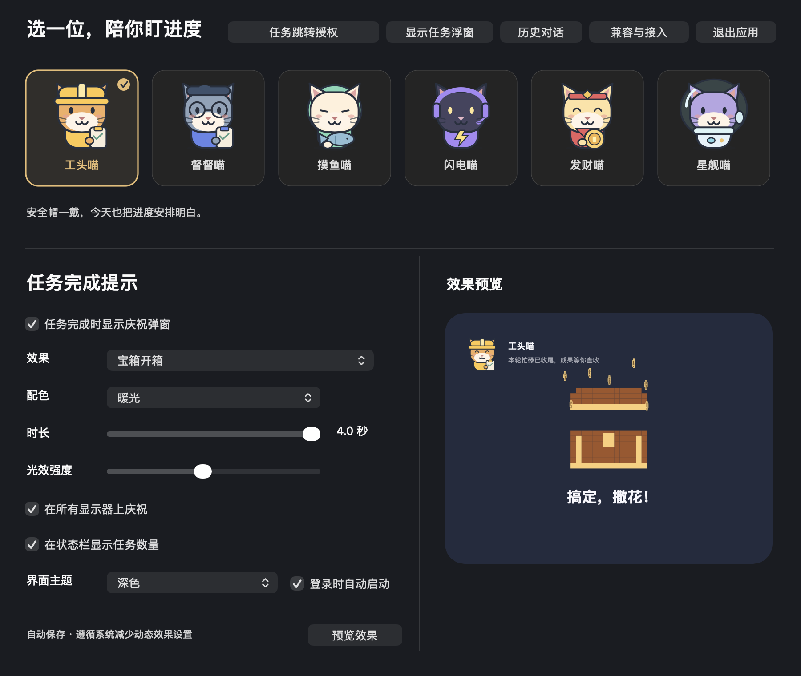

# 工头喵 · 多 AI 任务浮窗（Codex Buddy）

macOS 原生全局浮窗，集中展示不同 AI 助手的任务与完成提醒，保留已有 Codex 服务和设置。

## 核心界面

| 任务浮窗 | 主面板与庆祝预览 |
| --- | --- |
|  |  |

| 兼容与接入 | 工头喵小队 |
| --- | --- |
|  |  |

## 工头喵小队

点击菜单栏角色图标进入主面板，可以在六位伙伴中选择。默认是「工头喵」。切换角色后，浮窗头像和名称、菜单栏图标及完成庆祝同步更新。角色选择自动保存，重启后恢复。

| 角色 | 形象 |
| --- | --- |
| 工头喵 | 橘猫、安全帽与进度清单 |
| 督督喵 | 灰蓝猫、圆眼镜与检查表 |
| 摸鱼喵 | 奶油猫、薄荷兜帽与小鱼 |
| 闪电喵 | 深色猫、紫色耳机与闪电 |
| 发财喵 | 金色猫、红领巾与成就金币 |
| 星舰喵 | 淡紫猫、透明头盔与宇航服 |

角色在 `Sources/Mascot.m` 以原生矢量绘制，适配小图标与大预览，不依赖网络下载。[角色预览](docs/previews/mascots.png) · [设置预览](docs/previews/mascot-settings.png)。

## 历史对话

从主面板点击「历史对话」可展开历史列表。展开浮窗后可在小猫右侧切换「当前」和「历史」。历史对话按最近更新时间倒序排列，默认展示 10 条，点击「再显示 10 条」继续加载。点击记录返回聊天或对应应用，悬停查看更新时间。已读记录也会保留在历史列表中。Codex 读取未归档主对话，其他来源展示本地会话或已接收事件所能提供的记录。

## 多产品兼容

第一批共 16 个接入来源：Codex、Claude Code、Cursor、GitHub Copilot、Antigravity、Gemini CLI / Code Assist、Windsurf / Devin、OpenCode、TRAE、CodeBuddy、Qoder / Qoder CN、Qwen Code、千问「工作」、DeepSeek Harness、MiniMax Agent / Code、Kimi Code。

在主面板点击「兼容与接入」，可查看每个来源的接入方式、配置结果和读取异常。安装时自动为本机已存在的客户端目录添加观察事件，保留原有设置和 Hook，并备份修改前的文件。以后安装新客户端，可在此页面点击「接入已安装客户端」，然后在对应客户端重新开启会话。配置成功表示接入已准备好，收到真实事件后才显示「已收到任务」。

- Codex 沿用只读数据库、事件日志和已读回执。
- DeepSeek Harness、MiniMax Code、CodeBuddy 读取本地会话数据；首次接入跳过历史完成记录，后续观察到的完成结果保留至标记已读。
- Claude Code、Cursor、Copilot CLI、Antigravity、Gemini CLI、Windsurf / Devin、TRAE、CodeBuddy、Qoder、Qwen Code、Kimi Code 使用各自的事件配置；OpenCode 提供 V2 和 V1 1.18.29+ 的本地事件插件，并兼容 V1 SQLite 会话读取。
- 点击 Antigravity 任务可打开对应会话，子任务会打开所属主会话。首次使用可在「主面板 → 任务跳转授权」打开 macOS 权限设置，允许「工头喵」后再次点击任务。临时签名版更新后可能需要重新授权。同一入口也在「兼容与接入」中，未授权时浮窗会提示「去授权」。无法自动定位时会复制会话 ID，可在 Antigravity 按 `⌘K` 粘贴搜索。仅成功自动定位后才标记提醒已读。
- 千问 macOS 客户端的「工作」模式直接读取本地任务记录，无需辅助功能授权。工头喵显示进行中、待输入和已完成，点击任务可回到千问的对应会话。取消和错误结束只留在历史中。此接入覆盖写入本机记录的工作任务。
- 每行右侧显示对应应用的本地图标，悬停显示来源名称；未找到本地图标时显示备用图标。Codex 可直接跳转聊天；其他产品尚未验证会话深链时返回对应应用。成功跳转后，待输入和已完成提醒自动标为已读并移除，也可右键「标为已读」。CLI 会话提供「复制会话恢复命令」，不自动向终端输入或执行。

**验证范围：** 本机已读取 Codex、DeepSeek Harness 0.2.2-rc.1、MiniMax Code 3.1.16、CodeBuddy CN 4.12.4 的真实存储格式；其他接入按官方事件协议实现并使用隔离事件测试。尚未逐款完成真实任务从开始到结束的验收。各产品云端任务、第三方封装版以及不同历史版本不视为自动兼容。详见 [兼容矩阵与验证记录](docs/兼容矩阵-20261118.md)。

### Claude 优先接入

Claude 桌面的 **Code 本地会话**与 Claude Code CLI 使用 `~/.claude/settings.json` 中的同一套事件配置。已覆盖开始、工具调用、权限审批、结构化提问、MCP 提问、正常结束及 API 错误结束；并行工具完成不会清除其他尚未回答的问题，子 Agent 事件不会改变主任务状态。CLI 提供可复制的 `claude --resume` 命令，点击任务返回 Claude 应用。


本机 Claude 3.1623.0 已确认打开 Code 新会话页，目前尚无真实任务事件；已完成配置命令到接收器、状态聚合及原生 UI 的隔离测试。真实新任务、审批、停止和普通聊天生成流程仍待实际会话验证。

## 下载安装

从 [GitHub Releases](https://github.com/campoyaeh/codex-buddy/releases/latest) 下载 macOS DMG 安装包。打开 DMG 后，将「工头喵.app」直接拖入右侧「Applications（应用程序）」文件夹，双击打开即可使用，无需 `sudo`。

首次启动会自动打开主面板，并尝试为本机已安装的 AI 客户端配置观察事件。可在主面板直接勾选「登录时自动启动」，或在「兼容与接入」页面随时点击「接入已安装客户端」或「移除接入配置」。

安装包包含 Apple Silicon 和 Intel 通用二进制，最低部署目标为 macOS 12，需要可运行的 `/usr/bin/python3`。缺少 Python 3 时，应用会提示先在终端执行 `xcode-select --install`。不要求安装 Codex；各来源独立读取，某一客户端更新导致读取异常时，其余来源仍可工作。

当前发布包未使用 Apple Developer ID 签名，也未经过 Apple 公证，首次打开时 macOS 可能提示“无法验证开发者”。核对来源和 SHA256 后，可在「系统设置 → 隐私与安全性」点击「仍要打开」（或在 Finder 中右键图标选择「打开」）。发布页同时提供 SHA256 校验文件。Intel 与其他 macOS 版本的真机运行尚待验证。

> 如需使用命令行脚本安装到 `~/.codex/bin/` 并注册 LaunchAgent，源码仓库仍保留 [scripts/install.sh](scripts/install.sh)。

### 安装权限

工头喵通过本地任务记录和客户端事件接入。Antigravity 自动跳转的辅助功能授权可单独开启。拖拽安装的应用位于 `/Applications/工头喵.app`（脚本安装版位于 `~/.codex/bin/工头喵.app`）。

任务数据与设置保存在当前用户的 `~/.codex/task-manager/`，配置事件前会将原有文件备份到该目录下的 `backups/`。仓库包含源码、测试和打包脚本。

- 展示已接入来源进行中、待输入 / 审批及已完成未读的任务，Codex 包括自动化聊天。
- 任务依次展示：需确认（待输入 / 审批）、已完成、进行中。每行显示状态圆点和任务标题，黄色表示待输入，绿色表示进行中，蓝色表示完成。圆点与标题共用垂直中心。
- 点击任务标题返回聊天或对应应用。正在执行中的任务继续保留；待输入、已完成任务成功打开聊天或对应应用后标为已读并淡出移除。打开应用须等待系统确认成功，打开失败保留提醒；仅复制 CLI 恢复命令时继续保留，可右键标为已读。移除记录按来源、会话、轮次保存，后续新任务会重新出现。
- 浮窗可拖动、跨桌面置顶，按任务数量调整高度，多任务支持滚动。
- 空闲时自动收起为 206 × 40 点胶囊，新任务或待输入状态出现时自动展开。支持手动收起，可在主面板显示或隐藏浮窗。
- 任务完成时蓝色高亮、播放菜单栏轻弹动效，并在屏幕上方展示紧凑的完成提示（最大 440 × 340 点）。深靛蓝底面保留 90% 可见度，配合系统磨砂效果，像素动画与文案清晰展示，默认持续 4 秒。提示允许鼠标点击穿透并保持键盘焦点。已完成未读任务持续展示，重启后恢复，读取 Codex 的已读回执后移除，或点击浮窗对应任务后移除。系统开启减少动态效果时，使用静态像素场景，省略菜单栏弹动。
- 启动时恢复进行中和未回答的问题，已完成未读任务恢复展示，已读及已停止的任务自动移除。

## 主面板与庆祝设置

左键点击菜单栏图标进入主面板。菜单栏右键提供「进入主面板」和「退出应用」。主面板可显示或隐藏浮窗、打开历史对话、查看兼容与接入及退出应用。

在主面板或右键点击任务浮窗背景的「界面主题」，可选择深色、浅色或跟随系统。默认深色，两处共用同一设置，修改即时生效并会自动保存。

设置中的「在状态栏显示任务数量」默认开启。关闭后立即隐藏状态栏入口，浮窗提供右键入口进入主面板。退出后，应用会在下次登录时启动。也可在终端运行 `launchctl kickstart "gui/$(id -u)/com.openai.codex-task-complete-popup.watch"` 立即重新启动。

- 开启或关闭任务完成庆祝。
- 内置 150 条完成提醒，包含「生命不息，牛马不停」等打工人文案。每次完成和预览随机选择一条，连续两次避免重复，同次多屏展示相同文案。
- 默认「随机」，每次完成从十种效果中选择一种，连续两次使用不同效果。也可在「主面板 → 任务完成提示 → 效果」固定使用某一种。
- 「像素通关」采用像素勾选、分段进度条与方形粒子。
- 「金币到账」采用旋转像素金币与金币雨。
- 「火箭交付」采用像素火箭升空、跳动尾焰与星点。
- 「宝箱开箱」采用宝箱开盖、金币跃出动画。
- 「升级时刻」采用像素徽章、上升箭头与升级进度条。
- 「猫爪盖章」的猫爪印随指针移动。
- 「星座连线」的星星被指针牵引，连线随之改变。
- 「气泡派对」的气泡遇到指针时散成星点。
- 「纸飞机巡游」的飞机朝指针转向，留下点状轨迹。
- 「小鱼追光」的小鱼摆尾游向指针。
- 配色支持暖光与冷光。
- 持续时间可调 1–4 秒，默认 4 秒，包含淡入淡出。
- 光效强度可调，默认使用柔和亮度。
- 提示采用无描边的大圆角深靛蓝底面，背景、系统磨砂和像素画布采用一致圆角裁切，背景固定保留 90% 可见度，加入系统磨砂效果。像素图形与文字独立绘制。
- 默认在任务浮窗所在屏幕上显示，弹窗横向居中，中心距可见区域顶部约三分之一。可选择在所有显示器上同时播放同一个效果。
- 设置右侧提供独立预览区。切换效果、配色和调整时长、光效强度后自动播放，可点击「预览效果」重播。预览允许在庆祝开关关闭时播放，结束后保留静态场景，关闭设置窗口会清理预览计时器。

设置自动保存在 `~/.codex/task-manager/settings.json`，可复制到其他安装共享。未提供的字段采用默认值。重启恢复的已完成任务不会播放庆祝，同批完成合并为一次效果，播放中的后续完成沿用当前结束时间。

庆祝视图与设置实现位于 `Sources/Celebration.h`、`Sources/Celebration.m`，通过现有任务完成状态变化触发。

## 构建与安装

运行 `./scripts/install.sh`，使用系统 clang 和 Python 3。安装支持首次安装与升级，会备份已有提醒程序，并安装、启动 LaunchAgent 服务。

运行 `./scripts/package.sh 0.1.0` 构建通用二进制及 DMG 安装包，输出到 `dist/`，同时生成 SHA256 校验文件。

原生浮窗源码位于 `Sources/TaskPanel.m`，Codex 读取逻辑位于 `Sources/task_monitor.py`。多来源采集位于 `Sources/providers.py`，事件接收位于 `Sources/task_bridge.py`，接入配置位于 `Sources/integrations.py`。状态写入 `~/.codex/task-manager/`，数据库以只读模式打开。

已读状态只读查询本地 `thread_read_receipts`，不修改 Codex 数据库。记录待输入和已完成任务的点击移除。运行阶段忽略移除记录，待输入任务恢复执行后会重新展示。打开运行中聊天后，其后产生的未读完成结果仍会展示。

输入状态依据 `request_user_input` 和 `request_user_input_async` 的结构化提问记录。点击待输入或已完成任务并成功跳转时写入本浮窗的轮次移除记录；所有来源统一处理，此记录只表示任务中心的提醒已读，不修改其他软件的原生已读状态。输入、审批及任务执行通过对应 Codex 聊天处理。

## 验证

```sh
/usr/bin/python3 -m unittest discover -s Tests -v
./scripts/build.sh
TASK_PANEL_DATA_DIR=/tmp/codex-task-panel-ui-test ./build/codex-task-complete-popup --preview --ui-test
TASK_PANEL_DATA_DIR=/tmp/ai-task-panel-ui-test ./build/codex-task-complete-popup --preview --integration-ui-test
TASK_PANEL_DATA_DIR=/tmp/foreman-mascot-ui-test ./build/codex-task-complete-popup --preview --mascot-ui-test
./build/codex-task-complete-popup --preview /tmp/task-panel-preview.png
./build/codex-task-complete-popup --preview /tmp/mascots.png --mascot-sheet
./build/codex-task-complete-popup --preview /tmp/settings.png --settings-preview
```

新安装产生的程序、源码及 LaunchAgent 备份保存在 `~/.codex/task-manager/backups/时间戳/`。恢复时将对应备份复制回 `~/.codex/bin/` 和 `~/Library/LaunchAgents/`，再重启 `gui/当前用户ID/com.openai.codex-task-complete-popup.watch`。早期本地备份仍保存在项目的 `backups/`。

事件配置备份位于同一 `backups/` 下的 `hooks-时间戳/`，包含原始相对路径。只移除本工具添加的观察事件可运行 `/usr/bin/python3 ~/.codex/bin/integrations.py --remove`；可用 `--provider claude` 等参数限定来源，原有用户 Hook 保留。
