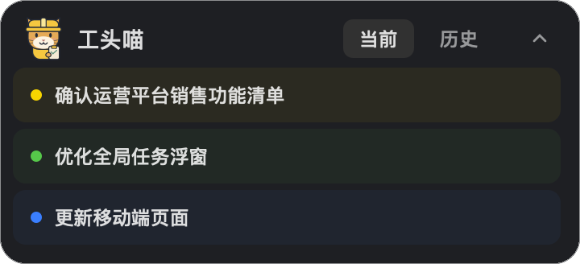
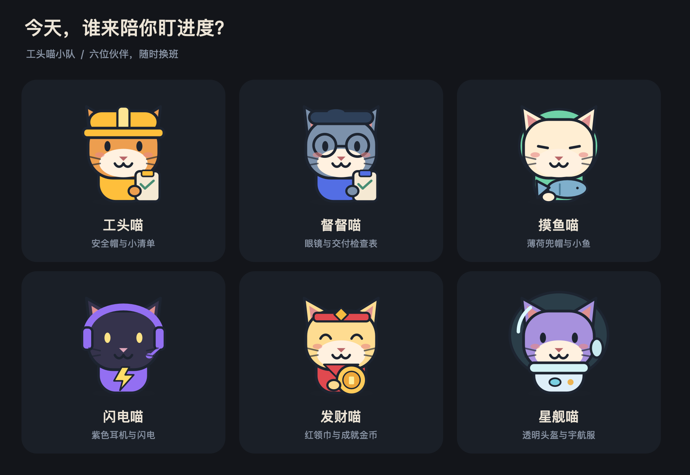
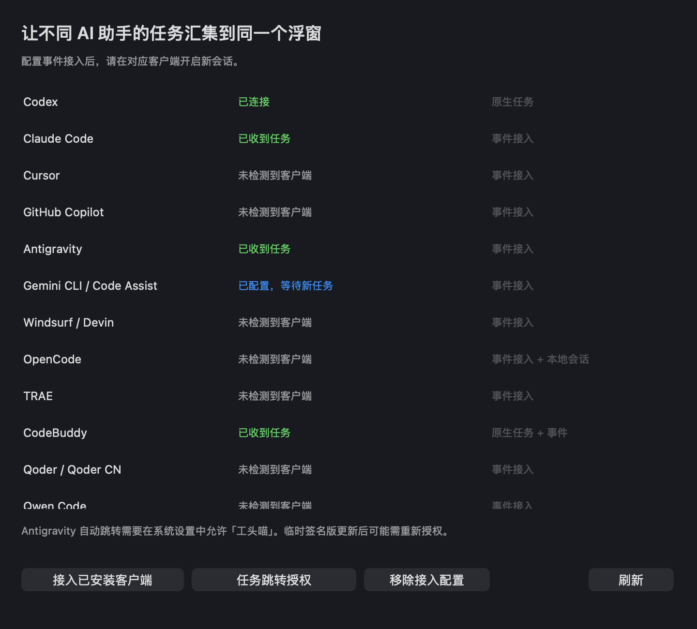

<div align="center">

# 工头喵 · Codex Buddy

**你的 macOS 多 AI 任务总管与桌面小助手**

把分散在各个 AI 编程与办公工具里的「进行中 / 待确认 / 已完成」任务，汇集到一块随时可看的桌面浮窗里。  
不切窗口不漏消息，任务完成还有打工猫猫给你放烟花。

[下载最新版 DMG](https://github.com/campoyaeh/codex-buddy/releases/latest) · [支持客户端](#支持-16-款-ai-助手) · [工头喵小队](#工头喵小队)

<br />


</div>

---

## 核心功能

### 1. 一块浮窗，盯紧所有 AI 进度
- **三态清晰排序**：🟡 待输入 / 审批（优先置顶）→ 🔵 已完成未读 → 🟢 进行中。
- **智能收起与展开**：空闲时自动缩成 `206 × 40` 迷你胶囊停在角落；有新任务或需要你确认时自动展开，跨桌面置顶且支持自由拖动。
- **点哪回哪**：点击任务直接跳回对应应用或会话（Codex、千问、Antigravity 等支持直达会话；CLI 会话支持一键复制恢复命令）。待确认或已完成任务跳转后自动标为已读并淡出，也可右键手动标为已读。
- **历史对话随时找**：支持在浮窗内切换「当前 / 历史」，按最近更新时间倒序展示，随时回溯过往会话。

<p>
  
</p>

---

### 2. 深色夜色 & 浅色主题，全天舒适护眼
- 默认采用**深色（夜色模式）**，高对比低刺眼，夜间编码与深色桌面浑然一体。
- 支持在**主面板**或**右键浮窗背景**中随时切换「深色 / 浅色 / 跟随系统」，浮窗与设置面板即时同步。
- 任务完成弹窗采用深靛蓝半透明磨砂底面，支持点击穿透，不抢键盘焦点、不打断当前打字。

---

### 3. 打工人专属「任务完成庆祝」
每次任务完成，屏幕上方都会送上一段轻巧的桌面庆祝（支持关闭，也可只在浮窗所在屏或所有显示器同时播放）：
- **150 条打工人文案**：「生命不息，牛马不停」等随机轮换，连续两次不重复。
- **10 种原生像素动效**：支持「随机」或固定选用，支持**暖光 / 冷光**、**1–4 秒时长**与**光效强度**调节，且自动适配系统「减少动态效果」。
  - **经典像素**：像素通关、金币到账、火箭交付、宝箱开箱、升级时刻
  - **指针互动**：猫爪盖章、星座连线、气泡派对、纸飞机巡游、小鱼追光（随鼠标移动产生互动）

---

## 工头喵小队

点击菜单栏图标进入主面板，可在 **6 位原创猫咪伙伴** 中自由切换。切换后，**浮窗头像、菜单栏图标与完成庆祝**会同步变身：

| 角色 | 形象与性格 |
| --- | --- |
| **工头喵** | 橘猫 · 戴安全帽与进度清单，稳重盯场（默认） |
| **督督喵** | 灰蓝猫 · 圆眼镜与检查表，严谨核对每一项 |
| **摸鱼喵** | 奶油猫 · 薄荷兜帽与小鱼，轻松陪跑不焦虑 |
| **闪电喵** | 深色猫 · 紫色耳机与闪电，极速响应每一轮 |
| **发财喵** | 金色猫 · 红领巾与金币，交付必有好彩头 |
| **星舰喵** | 淡紫猫 · 透明头盔与宇航服，探索长程任务 |

<div align="center">
  
</div>

---

## 支持 16 款 AI 助手

无需单独安装 Codex，各个来源相互独立，任意一款都能直接使用：

- **桌面 / IDE 助手**：Codex、Cursor、Antigravity、Windsurf / Devin、TRAE、CodeBuddy、Qoder / Qoder CN、千问「工作」
- **终端 / CLI 助手**：Claude Code（含桌面 Code 本地会话）、GitHub Copilot、Gemini CLI / Code Assist、OpenCode、Qwen Code、DeepSeek Harness、MiniMax Agent / Code、Kimi Code

> 首次打开会自动检测并接入本机已安装的客户端；后续新装了其他 AI 工具，只需在「兼容与接入」点一次 **「接入已安装客户端」**。如需卸载清理，点击 **「移除接入配置」** 即可无痕还原。  
> 详细版本适配情况可查看 [兼容矩阵与验证记录](docs/兼容矩阵-20261118.md)。

<p>
  
</p>

---

## 下载与安装

1. 从 [GitHub Releases](https://github.com/campoyaeh/codex-buddy/releases/latest) 下载最新的 `.dmg` 安装包（通用二进制，支持 Apple Silicon 与 Intel，需 macOS 12+）。
2. 打开 DMG，将 **「工头喵.app」** 拖入右侧 **「Applications（应用程序）」** 文件夹，双击运行即可。
3. 首次启动会自动打开主面板并完成客户端扫描，可在主面板按需勾选 **「登录时自动启动」**。

> **关于首次打开提示**：当前社区版未使用 Apple Developer ID 签名与公证，首次打开时若系统提示“无法验证开发者”，前往 **「系统设置 → 隐私与安全性」** 点击 **「仍要打开」**（或在图标上右键选择「打开」）即可。  
> **关于 Python 3**：若全新系统尚未安装系统 Python 3，应用会提示你在终端执行一次 `xcode-select --install`。  
> **Antigravity 一键跳转**：如需点击任务直接定位 Antigravity 对应会话，可在主面板点击 **「任务跳转授权」** 开启辅助功能权限；未开启时点击任务也会自动复制会话 ID，在 Antigravity 内按 `⌘K` 粘贴即可搜索。

<details>
<summary>开发者本地构建、命令行安装与测试（点击展开）</summary>

```sh
# 本地编译打包 .app
./scripts/build.sh

# 命令行安装到 ~/.codex/bin/ 并注册 LaunchAgent
./scripts/install.sh

# 生成通用 DMG 安装包
./scripts/package.sh 0.3.8

# 运行单元测试与原生 UI 回归测试
/usr/bin/python3 -m unittest discover -s Tests -v
TASK_PANEL_DATA_DIR=/tmp/codex-task-panel-ui-test ./build/codex-task-complete-popup --preview --ui-test
TASK_PANEL_DATA_DIR=/tmp/ai-task-panel-ui-test ./build/codex-task-complete-popup --preview --integration-ui-test
TASK_PANEL_DATA_DIR=/tmp/foreman-mascot-ui-test ./build/codex-task-complete-popup --preview --mascot-ui-test
```

</details>
